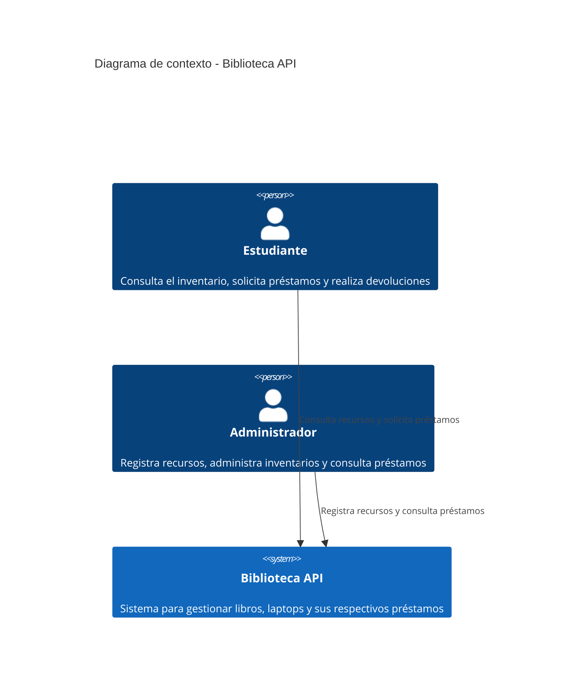
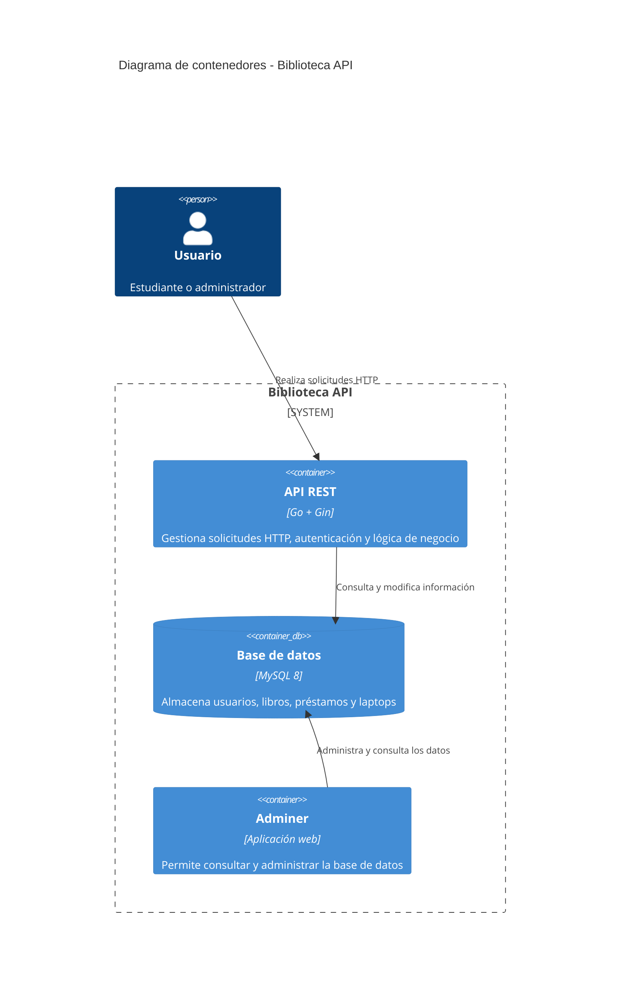
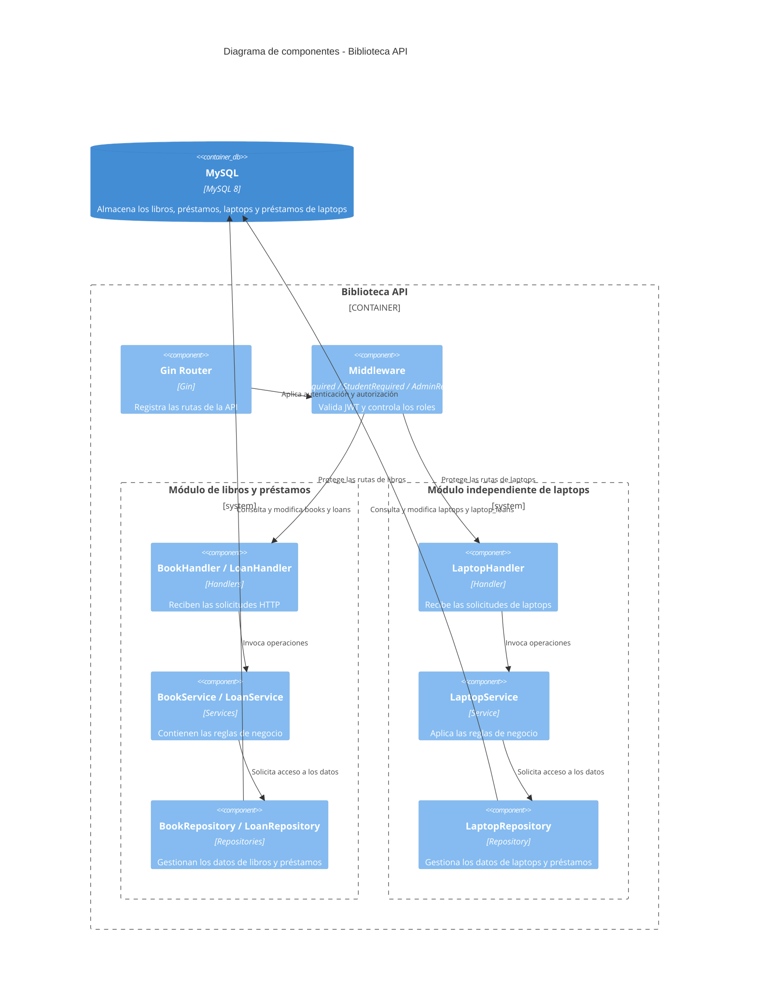
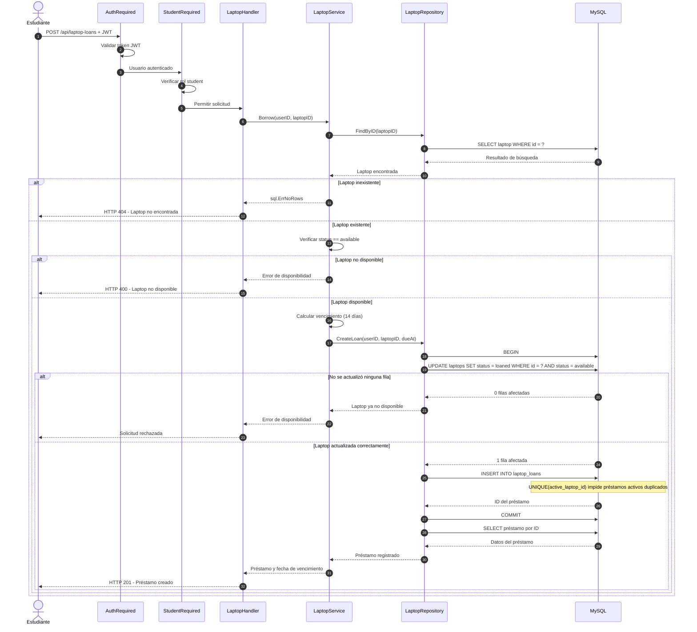

# Diagramas de arquitectura – Biblioteca API

## 1. Diagrama C4 – Contexto del sistema

Este diagrama representa la interacción entre los usuarios y el sistema Biblioteca API.

Se identifican dos actores principales:

- **Estudiante:** consulta el inventario de libros y laptops, solicita préstamos y realiza devoluciones.
- **Administrador:** registra libros y laptops, administra el inventario y consulta los préstamos realizados.

El sistema utiliza autenticación JWT para validar las solicitudes de los usuarios y controlar el acceso según sus roles.

## 2. Diagrama C4 – Contenedores

Este diagrama representa los principales contenedores que conforman la aplicación y su infraestructura de ejecución.

La arquitectura utiliza tres contenedores principales:

- **API REST:** desarrollada en Go con Gin. Gestiona las solicitudes, la autenticación y las reglas de negocio.
- **MySQL:** almacena usuarios, libros, préstamos, laptops y préstamos de laptops.
- **Adminer:** permite visualizar y administrar la base de datos.

Los contenedores se ejecutan mediante Docker Compose.

## 3. Diagrama de componentes – Arquitectura interna

## 3. Diagrama de componentes – Arquitectura interna

Este diagrama representa la organización interna de Biblioteca API y la incorporación del módulo de laptops.

Se identifican dos módulos independientes:

**Módulo de libros y préstamos:**
- Handlers: reciben las solicitudes relacionadas con libros y préstamos.
- Services: contienen las reglas de negocio.
- Repositories: realizan las operaciones en MySQL.

**Módulo de laptops:**
- LaptopHandler: recibe las solicitudes del inventario y los préstamos.
- LaptopService: aplica las reglas de negocio de las laptops.
- LaptopRepository: realiza las operaciones de persistencia.

Ambos módulos mantienen sus propios componentes y responsabilidades, pero comparten la infraestructura de autenticación JWT, el control de roles y la conexión a MySQL.

**Relación entre los módulos:** los préstamos de libros y laptops no comparten sus modelos, servicios ni repositorios. Cada uno administra sus propias tablas, mientras que ambos aprovechan los mecanismos de autenticación y persistencia de la aplicación.

## 4. Diagrama de secuencia – Préstamo de una laptop

Este diagrama representa el proceso que ocurre cuando un estudiante solicita una laptop mediante el endpoint `POST /api/laptop-loans`.

El flujo contempla las siguientes operaciones:

1. El estudiante envía una solicitud con su token JWT y el identificador de la laptop.
2. El middleware `AuthRequired` valida el token.
3. El middleware `StudentRequired` comprueba que el usuario tenga el rol de estudiante.
4. El handler recibe la solicitud y obtiene el identificador del usuario.
5. El servicio consulta si la laptop existe y verifica que tenga el estado `available`.
6. El servicio calcula la fecha de vencimiento de 14 días.
7. El repositorio inicia una transacción y actualiza el estado de la laptop a `loaned`, únicamente si todavía está disponible.
8. Si la actualización es correcta, registra el préstamo en `laptop_loans`.
9. MySQL aplica la restricción `UNIQUE` sobre `active_laptop_id` para impedir más de un préstamo activo por laptop.
10. Se confirma la transacción y se devuelve la información del préstamo.

Si la laptop no existe o ya no está disponible, la solicitud es rechazada.

## 5. Conclusión

Los diagramas representan la incorporación del módulo de laptops dentro de la arquitectura actual de Biblioteca API.

Se conserva la estructura general de la aplicación y se incorpora una nueva separación de responsabilidades para administrar los equipos y sus préstamos.

El módulo de laptops mantiene sus propios modelos, servicios, repositorios, handlers y tablas en MySQL. A su vez, reutiliza la autenticación JWT y los mecanismos de autorización existentes.

De esta manera, los préstamos de libros y laptops mantienen sus responsabilidades independientes, evitando modificar la lógica del módulo original de libros.